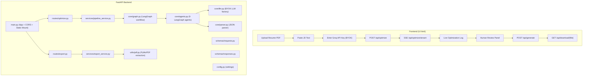

# FastAPI Backend — 3-Phase Implementation Plan

## Goal

Build a clean, modular FastAPI backend in `Web App/BackEnd/` that exposes the existing LangGraph resume optimization pipeline as a web API. The frontend (`UI.html`) will connect to this backend to provide a fully functional end-to-end experience.

---

## Architecture Overview



---

## Design Decisions (Locked)

| Decision | Choice |
|---|---|
| **Communication** | Server-Sent Events (SSE) for real-time pipeline progress |
| **Resume Input** | PDF file upload via `multipart/form-data` |
| **JD Input** | Paste text into a textarea (sent as string) |
| **Persistence** | No database — stateless, in-memory only |
| **Authentication** | BYOK (Bring Your Own Key) — Groq API key sent via `X-Groq-API-Key` header |
| **Export Formats** | DOCX + PDF (via `docx2pdf`) |
| **Human-in-the-Loop** | Yes — user can edit enhanced bullets before final document generation |
| **Code Strategy** | Clean refactor — extract pipeline logic into importable modules |
| **Directory Structure** | Layered modular (routes → services → core → schemas → utils) |
| **Logging** | Structured logging with Python `logging` module |
| **Frontend Serving** | FastAPI serves `UI.html` as a static file (single-origin) |
| **Rate Limiting** | In-memory, max 5 runs/minute/IP |
| **File Size Limit** | 10 MB max for resume PDF uploads |

---

## API Contract

### `POST /api/optimize/stream`

Starts the pipeline and streams SSE events.

**Request:** `multipart/form-data`
| Field | Type | Required | Description |
|---|---|---|---|
| `resume` | File (PDF) | ✅ | Resume PDF file (max 10 MB) |
| `jd_text` | string | ✅ | Job description text |

**Headers:**
| Header | Required | Description |
|---|---|---|
| `X-Groq-API-Key` | ✅ | User's Groq API key |

**Response:** `text/event-stream` (SSE)
```
event: status
data: {"agent": "validator", "message": "Validating document...", "progress": 10}

event: status
data: {"agent": "resume_parser", "message": "Parsing resume...", "progress": 20}

event: status
data: {"agent": "jd_parser", "message": "Parsing job description...", "progress": 30}

event: status
data: {"agent": "ats_score_before", "message": "Scoring ATS (before)...", "progress": 40}

event: status
data: {"agent": "gap_analysis", "message": "Analyzing skill gaps...", "progress": 50}

event: status
data: {"agent": "resume_enhancement", "message": "Enhancing resume...", "progress": 60}

event: status
data: {"agent": "critic", "message": "Critic reviewing...", "progress": 70}

event: status
data: {"agent": "ats_score_after", "message": "Scoring ATS (after)...", "progress": 80}

event: status
data: {"agent": "report_generator", "message": "Generating report...", "progress": 90}

event: result
data: {
  "ats_score_before": {...},
  "ats_score_after": {...},
  "gap_analysis": {...},
  "optimized_resume": {...},
  "final_report": {...}
}

event: done
data: {"message": "Pipeline complete", "elapsed_seconds": 87.3}
```

**Error Events:**
```
event: error
data: {"message": "Invalid API key", "code": "INVALID_API_KEY"}
```

---

### `POST /api/generate`

Generates final documents after human review/edits.

**Request:** `application/json`
```json
{
  "resume_data": {...},
  "optimized_resume": {...},
  "gap_analysis": {...},
  "user_edits": {
    "enhanced_bullets": [
      {"original": "...", "enhanced": "user-modified text", "section": "experience"}
    ]
  }
}
```

**Headers:**
| Header | Required | Description |
|---|---|---|
| `X-Groq-API-Key` | ✅ | User's Groq API key |

**Response:** `application/json`
```json
{
  "docx_url": "/api/download/abc123/resume.docx",
  "pdf_url": "/api/download/abc123/resume.pdf",
  "session_id": "abc123"
}
```

---

### `GET /api/download/{session_id}/{filename}`

Downloads a generated file.

**Response:** File download (`application/octet-stream`)

---

### `GET /api/health`

Health check endpoint.

**Response:**
```json
{"status": "healthy", "version": "1.0.0"}
```

---

## Directory Structure

```
Web App/BackEnd/
├── main.py                    # FastAPI app, CORS, static mount, startup
├── config.py                  # Settings (host, port, upload limits, temp dir)
├── requirements.txt           # Backend-specific dependencies
│
├── routes/
│   ├── __init__.py
│   ├── optimize.py            # POST /api/optimize/stream (SSE)
│   └── export.py              # POST /api/generate, GET /api/download
│
├── services/
│   ├── __init__.py
│   ├── pipeline_service.py    # Orchestrates LangGraph pipeline with SSE callbacks
│   └── export_service.py      # DOCX + PDF generation
│
├── core/
│   ├── __init__.py
│   ├── llm.py                 # BYOK LLM factory (get_llm_with_fallback)
│   ├── parser.py              # parse_json_from_response
│   ├── agents.py              # All 9 agent functions (validator, resume_parser, etc.)
│   ├── graph.py               # build_resume_analyzer_graph()
│   └── models.py              # Pydantic domain models (ResumeData, JDData, ATSScore, etc.)
│
├── schemas/
│   ├── __init__.py
│   ├── requests.py            # API request schemas
│   └── responses.py           # API response schemas + SSE event models
│
├── utils/
│   ├── __init__.py
│   ├── pdf.py                 # extract_text_from_pdf (PyMuPDF)
│   └── rate_limit.py          # In-memory rate limiter middleware
│
└── temp/                      # Temporary directory for generated files (gitignored)
```

---

## Phase 1: Foundation & Core Modules

> **Goal:** Set up the project structure, extract and refactor all pipeline logic into clean, importable modules. No API endpoints yet — just the reusable building blocks.

### [NEW] `Web App/BackEnd/requirements.txt`
- FastAPI, uvicorn, python-multipart, sse-starlette
- pymupdf, python-docx, docx2pdf
- langchain-groq, langchain-core, langgraph, pydantic
- python-dotenv, loguru (or stdlib logging)

### [NEW] `Web App/BackEnd/config.py`
- `Settings` class with:
  - `HOST`, `PORT`, `MAX_UPLOAD_SIZE` (10 MB)
  - `TEMP_DIR` path for generated files
  - `RATE_LIMIT_MAX` (5), `RATE_LIMIT_WINDOW` (60s)
  - `FRONTEND_DIR` (path to `Web App/FrontEnd/`)
  - `LOG_LEVEL`

### [NEW] `Web App/BackEnd/core/models.py`
- Extract from `ats_resume_builder.py` lines 21-65:
  - `ResumeData`, `JDData`, `OptimizedResume`, `ATSBreakdown`, `ATSScore`, `CriticOutput`, `FinalReport`
  - `GraphState` (TypedDict)

### [NEW] `Web App/BackEnd/core/llm.py`
- Refactor `get_llm_with_fallback()` to accept `api_key` as a parameter (BYOK)
- Remove global env variable dependency
- Signature: `get_llm_with_fallback(api_key: str, task_ambiguity: str = "low") -> BaseChatModel`

### [NEW] `Web App/BackEnd/core/parser.py`
- Extract `parse_json_from_response()` from lines 159-224
- No changes needed — it's already a pure function

### [NEW] `Web App/BackEnd/utils/pdf.py`
- Extract `extract_text_from_pdf()` from lines 126-147
- Add file-like object support (for uploaded `UploadFile`)

### [NEW] `Web App/BackEnd/core/agents.py`
- Extract all 9 agent functions, refactored to:
  - Accept `api_key` parameter (threaded through `GraphState`)
  - Use `logging` instead of `print()`
  - Remove inline test code
  - Remove hardcoded paths
  - Agents: `validator_agent`, `resume_parser_agent`, `jd_parser_agent`, `ats_score_before_node`, `ats_score_after_node`, `gap_analysis_agent`, `resume_enhancement_agent`, `critic_agent`, `report_generator_agent`, `resume_builder_agent`

### [NEW] `Web App/BackEnd/core/graph.py`
- Extract `build_resume_analyzer_graph()` from lines 827-876
- Parameterize to accept an `api_key` so the graph can be built per-request
- Remove `interrupt_before` (already done)

### [NEW] `Web App/BackEnd/schemas/requests.py`
- `OptimizeRequest` — used internally (resume text + JD text + API key)
- `GenerateRequest` — for the `/api/generate` endpoint (resume_data, optimized_resume, user_edits)

### [NEW] `Web App/BackEnd/schemas/responses.py`
- `SSEEvent` — event type + data payload
- `GenerateResponse` — download URLs
- `HealthResponse`
- `ErrorResponse`

### Verification
- [ ] All modules import cleanly: `python -c "from core.agents import validator_agent"`
- [ ] `parse_json_from_response` passes unit test with known inputs
- [ ] `extract_text_from_pdf` works with an uploaded file object
- [ ] `get_llm_with_fallback("test_key")` creates LLM instances without error

---

## Phase 2: API Endpoints & Pipeline Orchestration

> **Goal:** Build the FastAPI app with SSE streaming, HITL review, document generation, rate limiting, and health check.

### [NEW] `Web App/BackEnd/main.py`
- Create FastAPI app with:
  - CORS middleware (allow all origins for dev)
  - Static file mount for `Web App/FrontEnd/`
  - Include routers from `routes/`
  - Root route `/` serves `UI.html`
  - Startup/shutdown lifecycle events
  - Configure structured logging

### [NEW] `Web App/BackEnd/routes/optimize.py`
- `POST /api/optimize/stream`:
  - Accept `multipart/form-data` (resume PDF + JD text)
  - Extract `X-Groq-API-Key` header
  - Validate file size (≤ 10 MB) and type (PDF)
  - Extract text from uploaded PDF
  - Run pipeline via `pipeline_service` with SSE callback
  - Return `EventSourceResponse` streaming progress events

### [NEW] `Web App/BackEnd/routes/export.py`
- `POST /api/generate`:
  - Accept JSON body with resume data + user edits
  - Generate DOCX and PDF via `export_service`
  - Return download URLs
- `GET /api/download/{session_id}/{filename}`:
  - Serve generated files from temp directory
  - Auto-cleanup after download (or TTL-based)
- `GET /api/health`:
  - Return health status

### [NEW] `Web App/BackEnd/services/pipeline_service.py`
- `run_pipeline(resume_text, jd_text, api_key, event_callback)`:
  - Build LangGraph with BYOK api_key
  - Run each agent step
  - Call `event_callback` after each node completes (for SSE)
  - Return final state dict
  - Handle errors gracefully with error events

### [NEW] `Web App/BackEnd/services/export_service.py`
- `generate_documents(resume_data, optimized_resume, user_edits, session_id)`:
  - Merge user edits into optimized resume
  - Generate DOCX (using `python-docx`)
  - Convert DOCX → PDF (using `docx2pdf`)
  - Save to `temp/{session_id}/`
  - Return file paths

### [NEW] `Web App/BackEnd/utils/rate_limit.py`
- Simple in-memory rate limiter:
  - Track requests per IP with timestamps
  - 5 requests per 60-second window
  - FastAPI middleware or dependency injection
  - Return 429 Too Many Requests when exceeded

### Verification
- [ ] `uvicorn main:app --reload` starts without errors
- [ ] `GET /api/health` returns `{"status": "healthy"}`
- [ ] `POST /api/optimize/stream` with a test PDF streams SSE events
- [ ] `POST /api/generate` returns download URLs
- [ ] `GET /api/download/{session_id}/resume.docx` downloads the file
- [ ] Rate limiter blocks the 6th request within 60 seconds
- [ ] Missing `X-Groq-API-Key` header returns 401

---

## Phase 3: Frontend Integration (Wire UI.html to Backend)

> **Goal:** Update `UI.html` with JavaScript to make it a fully functional application connected to the FastAPI backend.

### [MODIFY] `Web App/FrontEnd/UI.html`

#### 1. BYOK API Key Input
- Add a modal/dialog that appears on first visit
- Input field for Groq API key
- Store in `sessionStorage` (cleared when tab closes)
- Wire to Settings gear icon button

#### 2. Resume Upload Zone
- Replace the static "LOCKED" resume panel with a drag-and-drop file upload zone
- Accept only `.pdf` files
- Show file name and size after selection
- Visual feedback (border highlight on drag-over)

#### 3. JD Input Zone
- Replace the static "LOCKED" JD panel with a textarea
- Placeholder text with instructions
- Character count indicator

#### 4. "Analyze" Button
- Add a primary CTA button below the ingestion column
- On click: validate inputs → `POST /api/optimize/stream` with FormData + API key header
- Disable button during processing

#### 5. Live Optimization Log (SSE Consumer)
- Wire the "LIVE OPTIMIZATION LOG" panel to consume SSE events
- `EventSource` connection to `/api/optimize/stream`
- Render each `status` event as a new log line with agent name
- Show progress percentage
- Color-code: green for success, red for errors, amber for critic feedback

#### 6. Results Display
- On `result` event: populate the Human Review panel
  - ATS score gauge in navbar (before → after)
  - Missing keywords chips
  - Enhancement preview (original vs optimized side-by-side)
- On `error` event: show error state in the error panel

#### 7. Human Review Controls
- **[Edit Enhancements]** button: make the optimized text editable (contenteditable or textarea swap)
- **[Approve & Generate]** button: `POST /api/generate` with the (potentially edited) data
- Show download links for DOCX and PDF after generation

#### 8. Download Handling
- After `POST /api/generate` returns URLs, show download buttons
- Clicking triggers `GET /api/download/{session_id}/{filename}`
- Browser's native download dialog opens

### Verification
- [ ] Open `http://localhost:8000` → UI loads
- [ ] Enter API key → stored in sessionStorage
- [ ] Upload a PDF resume → file name appears
- [ ] Paste JD → text visible
- [ ] Click Analyze → live log streams events
- [ ] Results populate the review panel
- [ ] Edit an enhancement → click Approve & Generate
- [ ] DOCX and PDF download successfully
- [ ] Refresh page → API key prompt reappears (sessionStorage cleared)

---

## Open Questions

> [!IMPORTANT]
> **docx2pdf on server:** The `docx2pdf` library requires Microsoft Word to be installed on the machine running the backend. This works fine on your Windows dev machine, but **will not work** on a Linux server or Docker container. If you plan to deploy this beyond your local machine, we should consider alternatives:
> - **Option A:** Use `python-pptx` + `reportlab` or `weasyprint` for server-side PDF generation (no MS Word dependency)
> - **Option B:** Keep `docx2pdf` for now (Windows-only) and address deployment later
>
> For now, I'll proceed with `docx2pdf` since you're developing on Windows.

> [!NOTE]
> **LaTeX export:** You chose DOCX + PDF only. The existing LaTeX generation via `resume_builder_agent` will be excluded from the web API. The `resume laytex format.tex` template and `pdflatex` dependency won't be needed in the backend. The agent will still generate DOCX, and PDF will be derived from that DOCX.

> [!NOTE]
> **Temporary file cleanup:** Generated DOCX/PDF files will be stored in `Web App/BackEnd/temp/`. I'll implement a TTL-based cleanup (delete files older than 30 minutes) to prevent disk bloat. Is 30 minutes acceptable, or do you want a different window?
